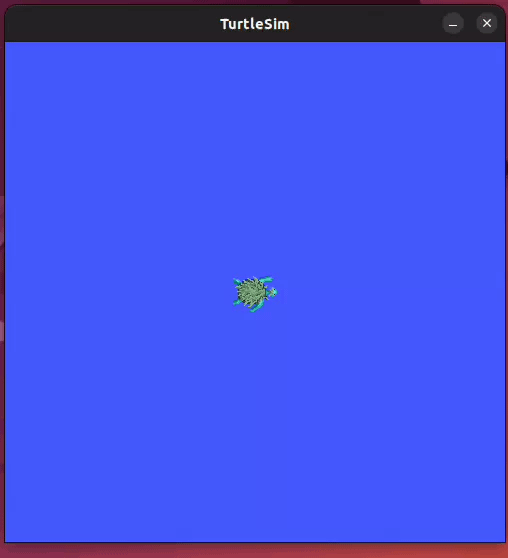
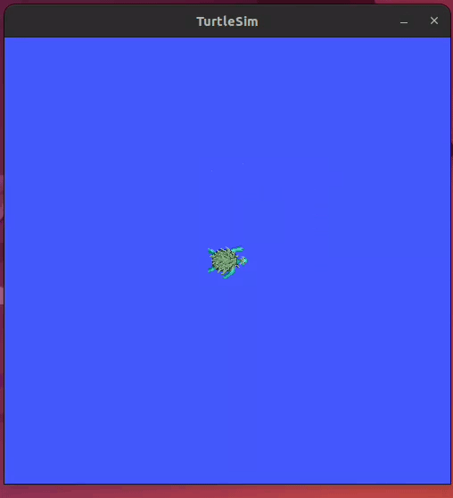
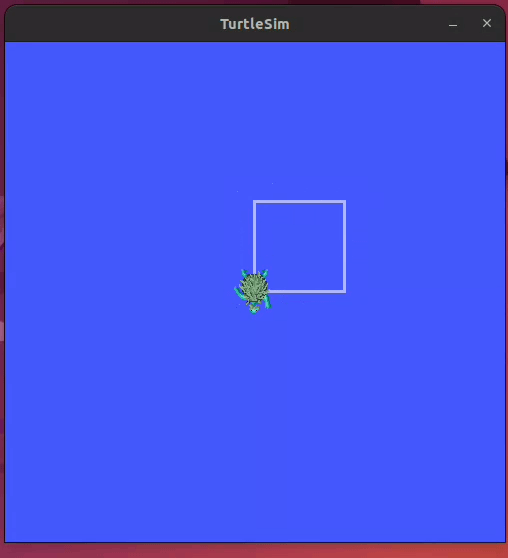

# ROS 2 Design Lab 1

<p align="center">
  <strong>A ROS 2 Jazzy assignment exploring nodes, custom interfaces, services, actions, parameters, and launch files through Turtlesim.</strong>
</p>

<p align="center">
  
  
  
</p>

---

## Overview

This repository contains a ROS 2 lab assignment built around **Turtlesim**. It brings together custom ROS interfaces and Python nodes to control the turtle, reset its pose, change movement speeds, and draw a square through an action-based workflow.

## Features

- **Custom interfaces** — a `TargetPose` message, `GoToPose` and `DrawSquare` actions, and a `Speed` service.
- **Pose control** — request a target position and yaw through an action server.
- **Square drawing** — use an action server/client workflow to coordinate the square-drawing task.
- **Reset service** — reset the Turtlesim state through a ROS service.
- **Runtime parameters** — configure pose, square side length, and movement speeds.
- **Launch files** — start the simulation and relevant nodes together.

## Repository structure

```text
Design-Lab-1-Ros2-Assignment/
├── bringup/
│   ├── config/       # YAML parameter files
│   └── launch/       # Launch descriptions
├── interfaces/
│   ├── action/       # GoToPose.action, DrawSquare.action
│   ├── msg/          # TargetPose.msg
│   └── srv/          # Speed.srv
├── my_packages/
│   └── my_packages/  # ROS 2 Python nodes
├── test_command.txt  # Useful commands for testing
└── README.md
```

### Package responsibilities

| Package | Purpose |
| --- | --- |
| `interfaces` | Defines the custom message, service, and action interfaces. |
| `my_packages` | Implements pose control, reset, square drawing, and related clients/nodes. |
| `bringup` | Stores launch files and YAML configuration. |

## Requirements

- Ubuntu 24.04
- ROS 2 Jazzy
- `turtlesim`
- `colcon` and the standard ROS 2 build tools

## Build and run

### 1. Clone into a ROS 2 workspace

```bash
mkdir -p ~/ros2_ws/src
cd ~/ros2_ws/src
git clone https://github.com/mohamed1293128-sketch/Design-Lab-1-Ros2-Assignment.git
```

### 2. Build the workspace

```bash
cd ~/ros2_ws
source /opt/ros/jazzy/setup.bash
rosdep install --from-paths src --ignore-src -r -y
colcon build --symlink-install
source install/setup.bash
```

### 3. Launch the system

```bash
ros2 launch bringup Task.launch.xml
```

The launch file starts Turtlesim along with the pose-control, square-drawing, and reset nodes.

> **Tip:** In a new terminal, source both ROS 2 and your workspace before running commands:
> `source /opt/ros/jazzy/setup.bash && source ~/ros2_ws/install/setup.bash`

## Try the interfaces

Run these in a terminal after sourcing the workspace and starting the required nodes.

### Go to a target pose

```bash
ros2 action send_goal /go_to_pose interfaces/action/GoToPose \
  "{target_pose: {x: 1.0, y: 3.0, yaw: 1.57}}" --feedback
```

### Change movement speed

```bash
ros2 service call /set_speed interfaces/srv/Speed \
  "{linear_velocity: 3.0, angular_velocity: 4.0}"
```

### Reset Turtlesim

```bash
ros2 service call /reset_node std_srvs/srv/Trigger "{}"
```

### Run the square-drawing node

The main launch file starts the square-drawing server. To test it independently, first make sure the required dependencies and action server setup are running:

```bash
ros2 run my_packages square_draw --ros-args -p side_length:=3.0
```

For more test commands, see [`test_command.txt`](test_command.txt).

## Visual demonstrations

### Draw a square

The GIF below shows the turtle completing the square-drawing workflow in Turtlesim.

<p align="center">
  
</p>

### Set a target pose

<p align="center">
  
</p>

### Reset Turtlesim

<p align="center">
  
</p>

The original recording is also available as [`assigmnent1.mp4`](assigmnent1.mp4).

## Team

| Name | Student ID |
| --- | ---: |
| Mohamed Maged | 9392 |
| Ahmed Abouelwafa Abdelmonsef | 9264 |
| Belal Ahmed Mohamed | 9508 |

---

## License

This project is licensed under the [MIT License](LICENSE). See the `LICENSE` file for the full license text.
